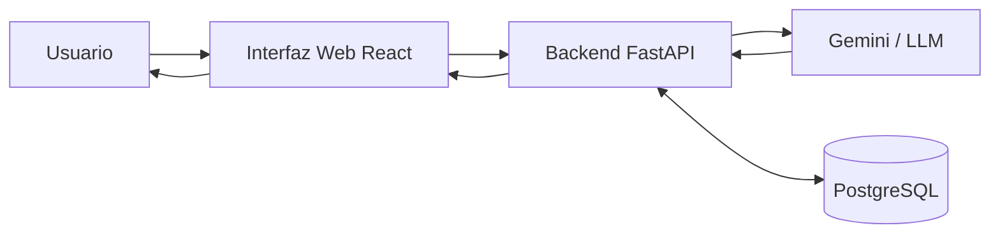
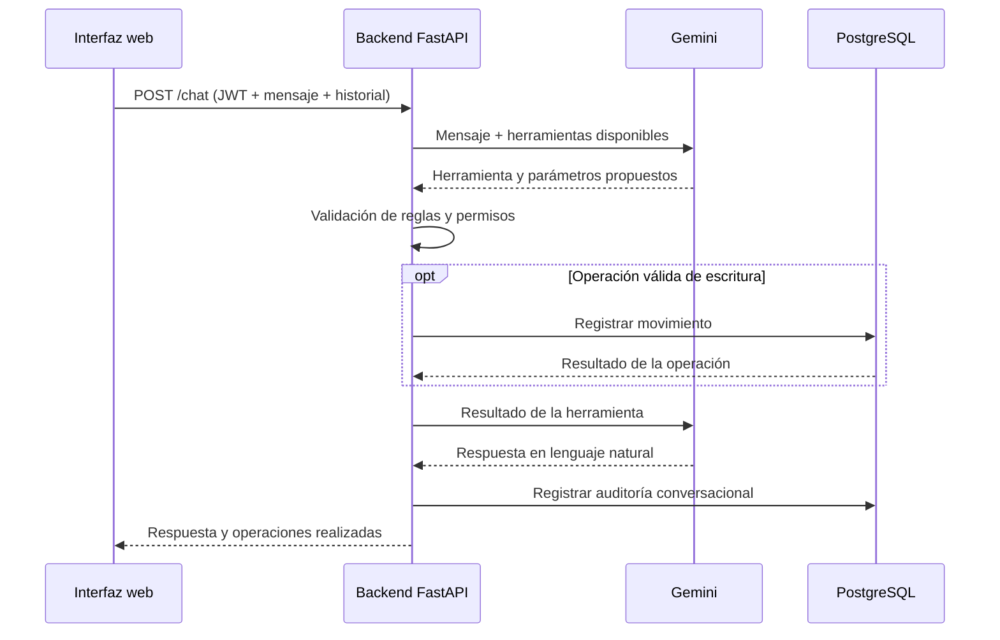

# Arquitectura del proyecto

## Objetivo

La Plataforma Conversacional de Finanzas Personales utiliza una arquitectura modular con separación de responsabilidades.

La interpretación del lenguaje natural está separada de las reglas de negocio y de la persistencia de datos.

El principio central de la arquitectura es:

> El agente interpreta. El backend decide.

El modelo de inteligencia artificial interpreta las solicitudes y propone operaciones, pero las reglas financieras son validadas y ejecutadas exclusivamente por el backend.

---

## Arquitectura general

El sistema utiliza una arquitectura web donde React se comunica con FastAPI, que integra el procesamiento conversacional mediante Gemini y administra la persistencia en PostgreSQL.

El flujo principal es:

`Usuario → React → FastAPI → Gemini → FastAPI → PostgreSQL → Respuesta`



El frontend no se comunica directamente con Gemini ni con PostgreSQL. Todas las solicitudes pasan por FastAPI, que controla la autenticación, autorización y ejecución de operaciones.

---

## Componentes principales

### Interfaz Web

Es el punto de acceso del usuario al sistema.

Permite registrarse, iniciar sesión, administrar cuentas, consultar movimientos e interactuar mediante lenguaje natural con el asistente financiero.

**Tecnología:** React.

### Procesamiento conversacional

El sistema utiliza Gemini mediante su API, compatible con el formato de Chat Completions de OpenAI.

El modelo interpreta los mensajes y propone llamadas a herramientas (*function calling*) con parámetros estructurados.

Si falta información necesaria para ejecutar una operación, el sistema solicita una aclaración en lugar de completar datos arbitrariamente.

Gemini no tiene acceso directo a la base de datos y no ejecuta operaciones financieras por su cuenta.

### Backend

FastAPI centraliza las reglas de negocio y expone los endpoints REST utilizados por la interfaz.

Sus responsabilidades incluyen:

- Validar autenticación y autorización mediante JWT.
- Comprobar la propiedad y el estado de las cuentas.
- Validar categorías, importes, fechas y monedas admitidas.
- Ejecutar operaciones de ingresos y gastos.
- Calcular saldos y generar consultas.
- Procesar las solicitudes conversacionales y controlar la ejecución de herramientas.

Las validaciones financieras comunes se encuentran centralizadas para evitar comportamientos diferentes entre las operaciones REST y las solicitudes del asistente.

### Base de datos

PostgreSQL constituye la fuente de verdad del sistema.

Almacena usuarios, cuentas, categorías, movimientos y registros de auditoría conversacional.

El acceso a PostgreSQL se realiza exclusivamente desde el backend mediante SQLAlchemy.

---

## Implementación del flujo conversacional

La interfaz web envía los mensajes a `POST /chat`, incluyendo el JWT del usuario y el historial conversacional correspondiente.



### Reglas del flujo

- Gemini interpreta el mensaje y propone una herramienta, pero no modifica datos directamente.
- La identidad del usuario se obtiene exclusivamente del JWT.
- Las herramientas se ejecutan desde el backend mediante `app/agent/tools.py` y `app/routers/tools.py`.
- Las operaciones reutilizan las reglas financieras implementadas por el backend.
- Se permite como máximo una operación de escritura exitosa por mensaje.
- Si faltan datos o existe una ambigüedad detectada, se solicita una aclaración y no se ejecuta la operación correspondiente.
- Si el proveedor de IA falla antes de registrar un movimiento, no se ejecuta la escritura.
- Si el movimiento ya fue registrado y falla la generación de la respuesta, el backend conserva la operación e informa al usuario.
- Las interacciones procesadas por el chat se registran en `audit_logs`.

### Proveedor de IA reemplazable

El cliente de IA utiliza el formato de Chat Completions de OpenAI, compatible con Gemini y otros proveedores o gateways que implementen esa interfaz.

La configuración se realiza mediante variables de entorno:

- `LLM_BASE_URL`: dirección del proveedor.
- `LLM_API_KEY`: credencial de acceso.
- `LLM_MODEL`: modelo seleccionado.
- `LLM_FALLBACK_MODEL`: modelo alternativo opcional.
- `LLM_TIMEOUT`: tiempo máximo de respuesta.

| Entorno | Integración |
|---|---|
| Desarrollo local | Gemini mediante API directa |
| Despliegue online | Gemini mediante API directa |
| Integración alternativa | Gateway de OpenClaw, disponible en el repositorio |

El despliegue definido en `render.yaml` utiliza `gemini-flash-latest` como modelo principal y `gemini-flash-lite-latest` como respaldo.

La configuración local puede utilizar otro modelo compatible según las credenciales y la disponibilidad.

OpenClaw y su servidor MCP permanecen como componentes de integración alternativa, pero **no forman parte del flujo principal de la aplicación web del P0**.

La elección de un proveedor diferente no requiere modificar las reglas financieras del backend.

---

## Arquitectura interna del backend

El backend está organizado en módulos con responsabilidades diferenciadas:

```text
backend/
├── app/
│   ├── main.py
│   ├── database.py
│   ├── security.py
│   ├── agent/
│   ├── models/
│   ├── schemas/
│   ├── services/
│   └── routers/
├── alembic/
├── evaluacion/
├── tests/
└── requirements.txt
```

Responsabilidades principales:

- `agent/`: cliente del proveedor de IA, instrucciones del asistente y definición de herramientas.
- `routers/`: endpoints REST, operaciones financieras y canal conversacional.
- `services/`: validaciones financieras compartidas.
- `schemas/`: estructuras de entrada y salida y validaciones mediante Pydantic.
- `models/`: entidades persistidas en PostgreSQL.
- `security.py`: autenticación, tokens y verificación de contraseñas.
- `database.py`: configuración del acceso a PostgreSQL.
- `alembic/`: migraciones y versionado del esquema.
- `tests/`: pruebas automatizadas de autenticación, operaciones y reglas de negocio.
- `evaluacion/`: conjunto de frases y script para evaluar el comportamiento del asistente con lenguaje natural.

El contrato de herramientas se documenta en `docs/tools.md`.

---

## Tecnologías

| Componente | Tecnología |
|---|---|
| Frontend | React |
| Procesamiento conversacional | Gemini mediante API |
| Ejecución de herramientas | Function calling gestionado por FastAPI |
| Backend | Python + FastAPI |
| Validación | Pydantic |
| ORM | SQLAlchemy |
| Base de datos | PostgreSQL |
| Migraciones | Alembic |
| Autenticación | JWT |
| Testing automatizado | pytest |
| Evaluación conversacional | Script Python y casos de lenguaje natural |
| Control de versiones | Git + GitHub |
| Despliegue | Render |
| Integración alternativa | OpenClaw y MCP |

El despliegue comprende PostgreSQL, el backend FastAPI y el frontend React.

La infraestructura se define mediante `render.yaml`, sin necesidad de utilizar Docker para el alcance implementado.

---

## Justificación técnica

**FastAPI** permite desarrollar una API REST en Python y mantener separadas las responsabilidades de autenticación, procesamiento conversacional, validación y persistencia.

**PostgreSQL** fue seleccionado por su modelo relacional y las necesidades de integridad entre usuarios, cuentas, categorías y movimientos.

**SQLAlchemy** permite representar las entidades del dominio y administrar su persistencia, mientras que **Alembic** versiona los cambios en el esquema de datos.

**React** permite construir una interfaz basada en componentes reutilizables, separada de las reglas del backend.

**Gemini** permite interpretar instrucciones financieras expresadas en lenguaje natural y proponer llamadas a herramientas estructuradas.

**Function calling** permite que el modelo solicite operaciones sin ejecutarlas directamente. Las herramientas son procesadas y validadas por FastAPI.

La integración directa con Gemini fue elegida para el P0 porque permite cubrir las necesidades del canal web sin mantener un gateway adicional.

**OpenClaw** se conserva como integración alternativa para una posible ampliación de las capacidades del agente y sus canales de comunicación.

---

## Seguridad

La arquitectura implementa los siguientes mecanismos:

- Contraseñas almacenadas mediante hash.
- Validación de contraseñas durante el registro.
- Autenticación mediante JWT.
- Autorización de operaciones según el usuario autenticado.
- Separación de datos entre usuarios.
- Validación de propiedad y estado de las cuentas.
- Validación de montos y fechas antes de registrar movimientos.
- Restricción de operaciones financieras a pesos argentinos (ARS).
- Protección frente a determinadas solicitudes ambiguas o inválidas.
- Variables sensibles almacenadas fuera del código fuente.
- Acceso a PostgreSQL exclusivamente desde el backend.
- Ausencia de acceso directo de Gemini a la base de datos.

La identidad del usuario se determina por la autenticación del backend y nunca por información proporcionada por el modelo de lenguaje.

### Auditoría

El sistema registra las interacciones del canal conversacional mediante la tabla `audit_logs`.

Estos registros permiten consultar el mensaje recibido, las herramientas solicitadas, las decisiones del backend, la respuesta generada y el movimiento asociado, cuando corresponde.

La auditoría está orientada al procesamiento conversacional y no constituye un registro integral de todas las operaciones REST.

---

## Criterio de diseño

La separación de responsabilidades establece funciones claras:

- **React:** presenta la información y recibe las acciones del usuario.
- **Gemini:** interpreta solicitudes expresadas en lenguaje natural.
- **FastAPI:** valida, autoriza y ejecuta las operaciones.
- **PostgreSQL:** conserva los datos y el estado financiero.
- **pytest y evaluación conversacional:** permiten comprobar las reglas y analizar el comportamiento del asistente.

De esta manera, el sistema mantiene las decisiones financieras fuera del modelo de inteligencia artificial.

El backend puede probarse independientemente de Gemini y el proveedor conversacional puede reemplazarse sin modificar las reglas centrales del dominio.

> **El agente interpreta. El backend decide.**