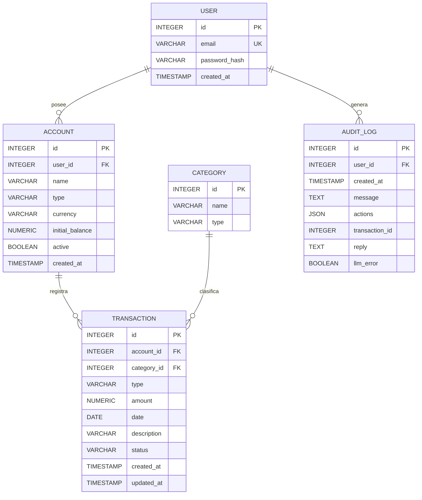

# Modelo de datos

## Objetivo

El modelo de datos de la Plataforma Conversacional de Finanzas Personales representa las entidades necesarias para registrar y consultar movimientos financieros personales.

Se priorizó un diseño relacional simple, que permite implementar las funcionalidades principales del P0, mantener la integridad de los datos y evitar complejidad innecesaria.

El sistema trabaja exclusivamente con pesos argentinos (ARS) y cuentas de disponibilidad. No realiza movimientos de dinero real ni se conecta directamente con entidades financieras.

---

## Entidades

### User

Representa a cada usuario registrado en la aplicación.

Campos principales:

- `id`: identificador único.
- `email`: correo electrónico utilizado para identificar al usuario.
- `password_hash`: contraseña almacenada de forma segura mediante hash.
- `created_at`: fecha y hora de creación.

Cada usuario puede tener múltiples cuentas financieras.

Durante el registro se valida el formato del correo electrónico y se exige una contraseña de al menos 8 caracteres y como máximo 72 bytes en UTF-8.

El correo electrónico debe ser único.

### Account

Representa una cuenta desde la cual el usuario registra ingresos y gastos.

Campos principales:

- `id`: identificador único.
- `user_id`: usuario propietario de la cuenta.
- `name`: nombre asignado.
- `type`: tipo de cuenta.
- `currency`: moneda.
- `initial_balance`: saldo inicial informado por el usuario.
- `active`: indica si la cuenta está activa.
- `created_at`: fecha y hora de creación.

Los tipos de cuenta admitidos son:

- `CASH`: efectivo.
- `BANK`: cuenta bancaria.
- `WALLET`: billetera virtual.

Ejemplos:

- Efectivo.
- Banco Nación.
- Mercado Pago.

Todas las cuentas utilizan `ARS`.

El backend aplica las siguientes validaciones al crear una cuenta:

- El nombre no puede estar vacío ni contener únicamente espacios.
- Se eliminan los espacios iniciales y finales.
- El nombre no puede superar 100 caracteres.
- Un usuario no puede crear dos cuentas activas con el mismo nombre, ignorando mayúsculas, minúsculas y espacios exteriores.
- El saldo inicial debe ser mayor o igual a cero.
- El saldo inicial admite como máximo dos decimales y debe respetar la precisión del campo numérico.
- El tipo y la moneda deben corresponder a los valores admitidos.

La desactivación de cuentas es lógica: se conserva la cuenta y sus movimientos, pero deja de estar disponible para nuevas operaciones.

### Category

Representa la clasificación de un ingreso o gasto.

Campos principales:

- `id`: identificador único.
- `name`: nombre de la categoría.
- `type`: indica si corresponde a un ingreso o gasto.

Los valores posibles de `type` son:

- `EXPENSE`: gasto.
- `INCOME`: ingreso.

Las categorías del P0 son globales y predefinidas por el sistema.

Categorías de gastos:

- Alimentación.
- Transporte.
- Vivienda.
- Servicios.
- Salud.
- Educación.
- Entretenimiento.
- Compras.
- Otros.

Categorías de ingresos:

- Sueldo.
- Honorarios.
- Inversiones.
- Otros.

Una categoría se identifica por su registro y su tipo. Por lo tanto, `Otros` puede existir tanto para ingresos como para gastos.

La creación de categorías personalizadas queda fuera del P0.

### Transaction

Representa un movimiento financiero registrado en una cuenta.

Campos principales:

- `id`: identificador único.
- `account_id`: cuenta asociada.
- `category_id`: categoría asociada.
- `type`: tipo de movimiento.
- `amount`: importe.
- `date`: fecha del movimiento.
- `description`: descripción opcional.
- `status`: estado del movimiento.
- `created_at`: fecha y hora de creación.
- `updated_at`: fecha y hora de última modificación.

Tipos de movimiento:

- `EXPENSE`: gasto.
- `INCOME`: ingreso.

Estados admitidos:

- `ACTIVE`: movimiento vigente.
- `VOIDED`: movimiento anulado.

Las operaciones deben cumplir las siguientes reglas de negocio:

- El monto debe ser mayor que cero.
- El monto admite hasta dos decimales.
- El importe máximo permitido es `9999999999999.99`.
- No se permiten fechas futuras.
- La cuenta debe existir, estar activa y pertenecer al usuario autenticado.
- La categoría debe existir y corresponder al tipo de movimiento.

Las reglas comunes de monto y fecha están centralizadas en `app/services/transaction_validation.py` y se aplican tanto a las operaciones REST como a las herramientas del asistente.

Los movimientos anulados no se eliminan físicamente. Permanecen en PostgreSQL con estado `VOIDED`, pero dejan de participar en el cálculo de saldos y en los reportes de gastos activos.

### AuditLog

Representa el registro de auditoría de las interacciones procesadas por el asistente conversacional.

Campos principales:

- `id`: identificador único.
- `user_id`: usuario que realizó la consulta.
- `created_at`: fecha y hora de la interacción.
- `message`: mensaje original del usuario.
- `actions`: herramientas solicitadas y decisiones del backend.
- `transaction_id`: identificador del movimiento generado, cuando corresponde.
- `reply`: respuesta del asistente.
- `llm_error`: indica si se produjo un error del proveedor de IA.

La auditoría permite reconstruir cómo fue procesada una solicitud conversacional.

Su alcance está limitado al canal `/chat`: no constituye una auditoría integral de todas las operaciones realizadas mediante los endpoints REST.

---

## Esquema relacional

Las tablas implementadas en PostgreSQL son las siguientes.

### users

| Campo | Tipo de dato | Restricciones |
|---|---|---|
| `id` | INTEGER | PK |
| `email` | VARCHAR(255) | NOT NULL, UNIQUE |
| `password_hash` | VARCHAR(255) | NOT NULL |
| `created_at` | TIMESTAMP | NOT NULL |

### accounts

| Campo | Tipo de dato | Restricciones |
|---|---|---|
| `id` | INTEGER | PK |
| `user_id` | INTEGER | FK → `users.id`, NOT NULL |
| `name` | VARCHAR(100) | NOT NULL |
| `type` | VARCHAR(20) | NOT NULL |
| `currency` | VARCHAR(3) | NOT NULL |
| `initial_balance` | NUMERIC(15,2) | NOT NULL |
| `active` | BOOLEAN | NOT NULL |
| `created_at` | TIMESTAMP | NOT NULL |

### categories

| Campo | Tipo de dato | Restricciones |
|---|---|---|
| `id` | INTEGER | PK |
| `name` | VARCHAR(100) | NOT NULL |
| `type` | VARCHAR(20) | NOT NULL |

### transactions

| Campo | Tipo de dato | Restricciones |
|---|---|---|
| `id` | INTEGER | PK |
| `account_id` | INTEGER | FK → `accounts.id`, NOT NULL |
| `category_id` | INTEGER | FK → `categories.id`, NOT NULL |
| `type` | VARCHAR(20) | NOT NULL |
| `amount` | NUMERIC(15,2) | NOT NULL |
| `date` | DATE | NOT NULL |
| `description` | VARCHAR(255) | NULL |
| `status` | VARCHAR(20) | NOT NULL |
| `created_at` | TIMESTAMP | NOT NULL |
| `updated_at` | TIMESTAMP | NOT NULL |

### audit_logs

| Campo | Tipo de dato | Restricciones |
|---|---|---|
| `id` | INTEGER | PK |
| `user_id` | INTEGER | FK → `users.id`, NOT NULL, INDEX |
| `created_at` | TIMESTAMP | NOT NULL |
| `message` | TEXT | NOT NULL |
| `actions` | JSON | NOT NULL |
| `transaction_id` | INTEGER | NULL |
| `reply` | TEXT | NOT NULL |
| `llm_error` | BOOLEAN | NOT NULL |

El campo `audit_logs.transaction_id` permite registrar el identificador del movimiento asociado, pero actualmente no posee una restricción de clave foránea hacia `transactions`.

**Nota:** las tablas reflejan el esquema implementado en las migraciones. Las validaciones adicionales de nombres, montos, fechas, monedas y estados se realizan principalmente en la capa de aplicación.

---

## Relaciones

Las relaciones principales del modelo son:

- Un `User` puede tener muchas `Account`.
- Cada `Account` pertenece a un único `User`.
- Una `Account` puede contener muchas `Transaction`.
- Cada `Transaction` corresponde a una única `Account`.
- Una `Category` puede clasificar muchas `Transaction`.
- Cada `Transaction` corresponde a una única `Category`.
- Un `User` puede tener muchos registros `AuditLog`.
- Cada `AuditLog` pertenece a un único `User`.

La relación entre `User` y `Transaction` es indirecta:

`Transaction → Account → User`

Esto evita almacenar redundantemente el usuario propietario dentro de cada movimiento.

El campo `transaction_id` de la auditoría funciona como referencia informativa y no como una relación de clave foránea implementada.

---

## Diagrama entidad-relación

---

## Índices y restricciones de unicidad

Los principales mecanismos implementados en el esquema actual son:

- `users.email`: restricción `UNIQUE`, que impide registrar correos electrónicos duplicados y permite su búsqueda mediante un índice único en PostgreSQL.
- `audit_logs.user_id`: índice `ix_audit_logs_user_id`, utilizado para facilitar las consultas de auditoría por usuario.
- Claves primarias: PostgreSQL crea índices asociados a las claves primarias de las cinco tablas.

Las columnas `accounts.user_id`, `transactions.account_id`, `transactions.category_id` y `transactions.date` participan en consultas y relaciones del sistema, pero no tienen índices adicionales definidos expresamente en las migraciones actuales.

La incorporación de índices específicos para estas consultas queda como una posible optimización futura, en función del volumen de datos y el rendimiento observado.

---

## Decisiones de diseño

### Separación entre usuario y movimiento

`Transaction` no almacena directamente un campo `user_id`.

La propiedad del movimiento se determina mediante:

`Transaction → Account → User`

Esto evita duplicar información y permite que la autorización se base en la cuenta propietaria del movimiento.

### Cálculo del saldo

El saldo actual no se almacena como un atributo independiente.

Se calcula mediante:

`Saldo actual = Saldo inicial + Ingresos activos - Gastos activos`

Solo se consideran los movimientos cuyo estado sea `ACTIVE`.

El saldo total presentado por el sistema corresponde a la suma de los saldos de las cuentas activas del usuario.

Cuando una cuenta se desactiva, sus movimientos permanecen almacenados, pero su saldo deja de formar parte del saldo total de cuentas activas.

### Anulación lógica

Los movimientos no se eliminan físicamente como procedimiento habitual de corrección.

Al anular una transacción:

- Su estado pasa de `ACTIVE` a `VOIDED`.
- Se conserva su información.
- Deja de afectar el saldo.
- Deja de contabilizarse en los reportes de gastos activos.

Este mecanismo permite mantener el historial de operaciones sin alterar físicamente los registros originales.

### Categorías predefinidas

Las categorías son compartidas por todos los usuarios y diferenciadas según el tipo de movimiento.

Durante el P0 no se permite crear categorías personalizadas.

El asistente puede proponer una categoría, pero el backend verifica que exista y corresponda al tipo de operación.

Ante determinadas expresiones ambiguas, el sistema solicita una aclaración antes de registrar el movimiento.

### Validaciones de aplicación

Además de las restricciones del esquema relacional, FastAPI y Pydantic aplican reglas de negocio adicionales:

- Validación de contraseñas en el registro.
- Validación de nombres y saldos iniciales de cuentas.
- Prevención de nombres duplicados entre cuentas activas del mismo usuario.
- Validación de importes y fechas de movimientos.
- Verificación de cuentas y categorías válidas.
- Autorización de operaciones según el usuario autenticado.

Estas reglas se encuentran en los esquemas, servicios y routers del backend. No todas están expresadas como restricciones `CHECK` o `UNIQUE` en PostgreSQL.

### Auditoría conversacional

La entidad `AuditLog` permite registrar las solicitudes procesadas por el asistente.

Su objetivo es facilitar la trazabilidad de la interpretación realizada por la IA y las decisiones del backend.

La auditoría no reemplaza las entidades financieras ni modifica el cálculo de saldos.

---

## Alcance implementado

El modelo del P0 contempla:

- Usuarios autenticados.
- Cuentas de efectivo, bancarias y billeteras virtuales.
- Ingresos y gastos.
- Categorías predefinidas.
- Operaciones exclusivamente en ARS.
- Cálculo dinámico de saldos.
- Anulación lógica de movimientos.
- Auditoría de interacciones conversacionales.

Quedan fuera del alcance inicial:

- Tarjetas de crédito.
- Múltiples monedas.
- Transferencias entre cuentas.
- Movimientos recurrentes.
- Presupuestos.
- Categorías personalizadas.
- Integraciones directas con bancos o billeteras.
- Auditoría integral de todas las operaciones REST.
- Mecanismos de idempotencia para reintentos de solicitudes.

Estas funcionalidades podrán evaluarse como evoluciones futuras sin modificar los principios centrales del modelo relacional.